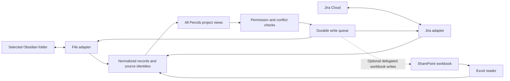

# Pencils integration design and feasibility

Research date: 16 October 2026. Baseline: Pencils 0.14.45 working tree. This is a proposal, not an implemented connector or a test against your Jira or Microsoft tenant. Jira Cloud and Microsoft 365 work or school accounts are assumed; Jira Data Center needs a separate adapter and estimate.

# Recommendation

Let a Pencils project contain several **data sources**, each with its own scope, credentials, permissions and sync policy. Start with a combined read view, then enable specific write operations. A task should retain its source identity; showing it on a board must not silently create a second authoritative task.

For Argus 2.1, a useful configuration would be:

| Source | Selected data | Initial mode | Where edits belong |
| --- | --- | --- | --- |
| Pencils and Obsidian | A selected local project folder | Read and write | The same Markdown files |
| Jira Cloud | A project or saved JQL query | Read first; selected writes later | Jira owns workflow, assignee and Jira fields |
| Excel on SharePoint | A named table in a selected workbook | Read first | Excel owns mapped row values |
| Pencils annotations | Board position, drawings and local notes | Read and write | Pencils only |

Every view would show a source badge and source key. Table could group by Source, then Assignee. Board cards would have an Open in source action, a last successful sync time, and a clear Pending, Conflict or Access lost state. Creating a task would ask for its destination, defaulting to the project's preference.

This design is a federation of records. Copying the same record into all three systems and allowing every field to change everywhere is a separate, substantially harder product.

# Shared architecture

Use a stable local record ID plus an external identity tuple. For Jira, store connection ID, cloud ID and issue ID; the displayed issue key can change. For Excel, store tenant, drive, file and table IDs plus a dedicated UUID column such as `PencilsID`; a row number is not an identity. For Markdown, use an explicit frontmatter or block ID and track renames.

Separate three things in storage: the last source snapshot, local annotations, and pending changes. Keep source snapshots and secrets outside a generally shared Obsidian vault by default. Exporting restricted Jira data into plain Markdown should be an explicit policy choice: app permissions cannot revoke an exported file.

Each adapter should expose capabilities such as read, create, edit fields, transition, assign, comment, attach, link and delete. Evaluate them per record, not just per connection. A source might permit editing a title but reject an assignee or a workflow transition.

## Ten shared requirements

| # | Requirement | Implementation |
| --- | --- | --- |
| 1 | Source setup wizard | Select account, project or file, scope, fields, direction and destination; preview records before enabling sync. |
| 2 | Field ownership | Mark each field Source owned, Editable through source, or Local only. Preserve unmapped data. |
| 3 | Mapping | Map source status IDs to common reporting categories; preserve the original status and type. Map people by source IDs with explicit reconciliation. |
| 4 | Durable sync | Persist jobs, checkpoints and retry state on the server. Use stable operation IDs, backoff and reconciliation after interruptions. |
| 5 | Conflict handling | Compare base, local and remote values. Merge independent field changes; ask on competing edits to the same field. |
| 6 | Safe deletion | Distinguish confirmed deletion, archive, query exclusion, permission loss and temporary failure. Keep recoverable local references. |
| 7 | Visibility boundaries | Enforce project access and source access on reads, search, exports, thumbnails and SSE updates, not only on buttons. |
| 8 | Auditable operations | Record source, actor, operation, outcome and correlation ID, excluding secrets and unnecessary content. |
| 9 | Connection health | Show last success, pending jobs, errors, reauthentication, limits and Pause or Disconnect. Explain what cached data remains. |
| 10 | Explicit linking | Let users link records across sources without merging them automatically. Cross-source dependencies stay local unless an adapter supports a deliberate remote representation. |

OAuth access is not permission to share everything the connected person can see with every Pencils user. For an initial personal installation, use one authenticated owner. For team use, prefer per-user credentials and permission-aware caches, or an administrator-approved shared source whose audience matches the Pencils project. This is a release requirement before importing confidential team data.

# Obsidian

## Best integration routes

Pencils already writes Markdown tasks and JSON Canvas boards and watches its project folders. Sharing that directory with Obsidian is the shortest path. The current store expects Pencils' folder structure and metadata; it does not automatically understand every checklist in an arbitrary vault.

There is also an official **Obsidian Headless Sync** client. It can synchronize a server-side vault without the desktop application running, supports continuous operation and requires an active Obsidian Sync subscription. Its documented modes include bidirectional and pull-only sync. Obsidian advises against running desktop Sync and Headless Sync for the same vault on the same device. It is currently an open beta, so treat it as an optional deployment component. [Headless Sync](https://obsidian.md/help/sync/headless), [Obsidian Headless](https://obsidian.md/help/headless).

An Obsidian plugin is useful later for a task sidebar, selection-to-task and source navigation. It is not required for basic file interoperability. Plugins inherit powerful application access; an in-plugin folder selector is an application rule, not an operating-system sandbox. [Plugin security](https://obsidian.md/help/plugin-security).

## Permissions

| Permission or access | Enables | Recommended default |
| --- | --- | --- |
| OS read access to the selected folder | Index notes, frontmatter and opted-in checkboxes | Required; limit the mounted directory |
| OS write access | Update tasks and create notes | Optional per connection; use a read-only mount for strict read mode |
| Rename and deletion access | Move or remove files | Disable initially; prefer trash and restore |
| Attachment directory read | Show linked images and files | Only within approved roots; preserve existing symlink restrictions |
| Attachment directory write | Save drawings and attachments | Explicit configured destination |
| Network access for Headless Sync | Synchronize a local replica with Obsidian Sync | Optional; keep its credentials outside project files |
| Obsidian plugin installation | In-app commands and vault event hooks | Optional; explain the plugin's broad trust boundary |
| Open external application links | Jump to the matching note | Use encoded `obsidian://` links, with a normal path fallback |

Obsidian's Vault API provides file operations and a `process` method for read-modify-write operations within Obsidian. That does not make writes from an independent Pencils process transactional. Preserve revision checks, re-read before mutation and retain recoverable versions. [Vault API](https://docs.obsidian.md/Plugins/Vault). Deep links can open a vault, file or block. [Obsidian URI](https://obsidian.md/help/uri).

## Ten achievable features

Effort here is incremental engineering time after the shared connector foundation; rows overlap and should not be summed as a quotation.

| # | Feature | Feasibility and approach | Extra effort |
| --- | --- | --- | --- |
| 1 | Existing Pencils tasks in Obsidian | High. Document a shared vault layout and preserve current Markdown metadata. | 1–2 days |
| 2 | Import arbitrary frontmatter tasks | High with a mapping screen, folder inclusion and a preview. | 3–5 days |
| 3 | Import checklist tasks | Medium. Opt in by folder/tag; assign stable block IDs, preserve surrounding prose. | 4–7 days |
| 4 | Bidirectional task field edits | High for supported schema. Field-level revision conflict handling is essential. | 3–5 days |
| 5 | Rename and move tracking | High with explicit IDs; path-only records require reconciliation. | 2–4 days |
| 6 | Linked images and attachments | High. Resolve relative paths safely; retain originals and generate previews. | 2–3 days |
| 7 | Open source note or block | High when the receiving device has that vault registered. | 0.5–1 day |
| 8 | Deleted task recovery | High for changes Pencils observes and snapshots. Do not promise recovery of never-indexed external files. | 2–4 days |
| 9 | Optional Headless Sync setup | Feasible after testing beta behavior, exclusions, credentials and deployment ownership. | 2–4 days |
| 10 | Obsidian companion plugin | Feasible for task creation, current-note context and status. A separately maintained client. | 7–12 days |

Main problems: competing file writers; different task syntaxes; duplicate block IDs after copy/paste; file watcher gaps; attachment paths; and accidental exposure of source data through a shared vault. Preserve unknown YAML and prose. Do not rewrite a whole note merely to change one checkbox. Use one sync transport for each folder rather than stacking multiple replication systems; Obsidian documents platform-specific limitations, particularly on iOS. [Syncing notes across devices](https://obsidian.md/help/sync-notes).

# Jira Cloud

## Authentication and permissions

Use OAuth 2.0 authorization code flow with user consent for the product connector. Keep tokens encrypted on the server; request offline access only when background synchronization is enabled. API tokens are a possible administrator-managed personal prototype, but should not be the default product setup. [Security for integrations](https://developer.atlassian.com/cloud/jira/platform/security-for-other-integrations/), [OAuth 2.0](https://developer.atlassian.com/cloud/jira/platform/oauth-2-3lo-apps/).

OAuth scopes and Jira permissions are separate gates. Classic scopes below are convenient, but broad; a narrower granular set must be derived from the exact endpoints used. Neither scope type overrides the user's Jira access. [Jira scopes](https://developer.atlassian.com/cloud/jira/platform/scopes-for-oauth-2-3LO-and-forge-apps/).

| Requested access | Scope or authorization | What it permits and what still applies |
| --- | --- | --- |
| Read issues, fields and relationships | `read:jira-work` | Jira project browsing and issue security still constrain records |
| Read visible user details | `read:jira-user` where needed | Does not guarantee email visibility; use account IDs |
| Create and modify work | `write:jira-work` | Broad scope, including destructive operations; Pencils should enforce a narrower capability policy |
| Background sessions | `offline_access` | Refresh tokens; revocation and reauthentication still apply |
| Dynamic webhooks | `manage:jira-webhook` | Optional event delivery; renew registrations |
| Project or global administration | `manage:jira-project`, `manage:jira-configuration` | Not needed for normal task synchronization; do not request by default |

For record operations, check Browse Projects and issue security first, then Create Issues, Edit Issues, Assign Issues and whether the target user is assignable, Transition Issues, and relevant field or workflow restrictions. Query allowed transitions and edit metadata instead of assuming every status can be assigned directly. [Issue API](https://developer.atlassian.com/cloud/jira/platform/rest/v3/api-group-issues/).

Comments require Add Comments; editing and deletion distinguish own versus all comments, and visibility restrictions remain relevant. Attachments need the corresponding project permission. Source deletion should be disabled by default even when a connected account has permission. [Comment API](https://developer.atlassian.com/cloud/jira/platform/rest/v3/api-group-issue-comments/), [Comment and attachment permissions](https://support.atlassian.com/jira-cloud-administration/docs/voters-watchers-comment-and-attachment-permissions/).

The connector's permission checklist should also include Schedule Issues for due-date changes, Link Issues for relationships, and Delete Issues only for an explicitly enabled destructive feature. Some workflows additionally require Resolve or Close permissions. Current Jira UI documentation may call issues “work items” and projects “spaces”; API permission identifiers can retain earlier names. Check the site's actual permission scheme and transition rules. [Work item permissions](https://support.atlassian.com/jira-cloud-administration/docs/use-manage-sprints-permission-for-advanced-cases/), [How permissions interact](https://support.atlassian.com/jira-cloud-administration/docs/how-does-jira-field-editability-work/).

## Ten achievable features

| # | Feature | Feasibility and constraints | Extra effort |
| --- | --- | --- | --- |
| 1 | Select project or JQL scope | High. Preview count and examples, handle pagination and query changes. | 2–3 days |
| 2 | Unified tasks in all views | High. Preserve issue IDs, keys, source URLs and original field values. | 3–5 days |
| 3 | Create Jira issues | High with create metadata and required-field validation. Avoid duplicate retries after ambiguous responses. | 3–5 days |
| 4 | Edit title, dates, priority and assignee | High for supported fields and permitted users. Re-fetch to verify the result. | 4–7 days |
| 5 | Change status | High through permitted workflow transitions, including required transition fields. | 3–5 days |
| 6 | Comments and replies where supported | Feasible; preserve source visibility and rich-text structure. Start with reading and posting plain text. | 3–5 days |
| 7 | Attachments | Feasible with limits, safe previews and source permission checks. | 2–4 days |
| 8 | Parent links and dependency arrows | Feasible with explicit mapping of hierarchy and issue-link types. Pencils arrows must not invent unsupported Jira parents. | 4–7 days |
| 9 | Custom fields and sprint information | Custom fields need typed mapping; boards and sprints add Jira Software API scopes. | 4–8 days |
| 10 | Incremental sync and recovery states | Poll changes with overlap and periodic reconciliation; optional webhooks later. Distinguish missing from inaccessible. | 4–7 days |

Jira v3 descriptions and comments use Atlassian Document Format. A complete Markdown round trip is not lossless. Preserve the original ADF, support an explicit subset, and offer Open in Jira for unsupported blocks. [REST API v3](https://developer.atlassian.com/cloud/jira/platform/rest/v3/).

For a LAN-only server, begin with outbound polling. Jira cannot call a private LAN address. Webhooks require a reachable HTTPS endpoint, verification, deduplication and renewal; dynamically registered webhooks expire after 30 days unless refreshed. A relay adds deployment and security work and is optional. [Webhooks](https://developer.atlassian.com/cloud/jira/platform/webhooks/), [Webhook registration API](https://developer.atlassian.com/cloud/jira/platform/rest/v3/api-group-webhooks/).

Other problems: tenant app restrictions, rate limits, field configuration differences, user deactivation, records moving outside the query, remote deletion and unsupported link semantics. A 404 or an empty JQL result is not sufficient proof of deletion. Maintain an access-lost state and never propagate a deletion solely from absence in a filtered search.

# Excel on SharePoint

## Choose the integration mode deliberately

**Reading a workbook file and calling Excel workbook APIs are different architectures.** The documented Graph endpoint for listing table rows requires delegated `Files.ReadWrite`, even for that read operation, and does not support application permissions. Workbook session creation also requires delegated access. Consequently, a client-credentials service cannot simply use the Excel table API for unattended synchronization. [List table rows](https://learn.microsoft.com/en-us/graph/api/table-list-rows?view=graph-rest-1.0), [Create workbook session](https://learn.microsoft.com/en-us/graph/api/workbook-createsession?view=graph-rest-1.0).

| Mode | Suitable for | Benefits | Tradeoffs |
| --- | --- | --- | --- |
| Download `.xlsx` and parse locally | Read-only unified task view | No workbook edits; can use appropriately granted file access | Parses a file snapshot; does not recalculate Excel formulas |
| Delegated Graph workbook API | Interactive and background work under a consenting user | Read and update a named table without replacing the whole file | Requires a user context and renewal; workbook contention and endpoint restrictions |
| SharePoint List instead of workbook | Reliable unattended record editing | Native item identities, permissions and conditional updates | Changes the source model; Excel can remain a reporting/export tool |

My recommended first release is read-only `.xlsx` import from a selected SharePoint workbook. Add delegated table writeback only after testing the actual tenant and a representative workbook. Avoid downloading, modifying and re-uploading an entire shared workbook while people are coauthoring it.

## Permissions

| Permission or grant | Purpose | Recommendation |
| --- | --- | --- |
| `Files.Read` delegated | Basic file download within the signed-in user's permitted scope | Use where sufficient for the selected file and endpoint |
| `Files.Read.All` delegated | Broader readable files the user can access | Only if the selected SharePoint access flow needs it |
| `Files.ReadWrite` delegated | Documented workbook table and session operations | Explain that a read-only Pencils mode still holds a write-capable token |
| `Files.ReadWrite.All` | Broad file editing | Avoid as a default; selecting one file in the UI does not narrow this scope |
| `Sites.Selected` | Access to explicitly granted sites | Useful for a controlled service deployment |
| `Files.SelectedOperations.Selected` | Access to explicitly granted files or library folders | Candidate for least-privilege file download; verify the actual endpoints in the tenant |
| `Lists.SelectedOperations.Selected` | Access to explicitly granted SharePoint lists | Useful for the List alternative |
| `ListItems.SelectedOperations.Selected` | Access to explicitly granted list items/files/folders | Usually more administration than this project needs |
| `openid`, `profile`, `offline_access` as appropriate | Sign-in and refreshable delegated session | Request only needed identity features; handle Conditional Access and revoked sessions |

Selected scopes require both Entra consent and an explicit resource grant, as well as an appropriate token. A grant can be `read` or `write`; higher owner/full-control roles should not be the connector's runtime default. Grants below the site level can break permission inheritance. Crucially, Selected scopes do **not** establish that every Excel `/workbook` endpoint supports them, and cannot override an endpoint's lack of application support. Use them for the file or list access path and verify compatibility. [Selected permissions](https://learn.microsoft.com/en-us/graph/permissions-selected-overview), [Permissions reference](https://learn.microsoft.com/en-us/graph/permissions-reference).

Tenant administrators may restrict consent even for delegated scopes. A resource owner or administrator must establish Selected grants with suitable authority; do not leave broad permission-management access in the runtime connector. File-picker selection is application scope, not a substitute for provider authorization.

## Ten achievable features

| # | Feature | Feasibility and constraints | Extra effort |
| --- | --- | --- | --- |
| 1 | Select a workbook and table | High; validate `.xlsx`, headers, table name and supported access mode. | 2–4 days |
| 2 | Map rows to tasks | High with typed mapping, required title and preview of invalid rows. | 3–5 days |
| 3 | Read-only background synchronization | High through file download and parsing; store ETag and poll only known resources. | 3–5 days |
| 4 | Read formula results | Feasible as values from the workbook; snapshot parsing cannot promise fresh recalculation. Preserve formulas as read-only. | 1–2 days |
| 5 | Stable row identity | Essential. Require a unique immutable ID column; detect duplicates and missing IDs before syncing. | 2–3 days |
| 6 | Edit mapped cells | Feasible through delegated workbook APIs; re-read target row by ID and serialize writes per workbook. | 5–8 days |
| 7 | Add task rows | Feasible; generate the ID before writing, detect retries and respect table formulas. | 3–5 days |
| 8 | Map assignees, statuses and dates | Feasible with explicit lookup tables, timezone/date rules and unmapped-value handling. | 3–5 days |
| 9 | Dependencies and attachment links | Use ID-list columns and URL columns; these are conventions, not native Excel task semantics. | 3–5 days |
| 10 | Comments and removal | Keep Pencils comments local initially. Offer an explicit soft-delete column; do not promise full Excel threaded-comment parity. | 2–4 days |

Require a real table with one header row. Sorting, inserting rows and filtering must not change identity. Support blank values, duplicate names and unknown columns deliberately. Reject ambiguous mappings before writing. Handle Excel date serials, 1900 versus 1904 date systems and text dates separately. Initially exclude merged data regions, password-protected workbooks, macros, arbitrary formulas and workbook restructuring from writeback.

Graph file download is a supported path; temporary download URLs are credentials in practice and should not be logged or exposed unnecessarily. Drive change tracking reports file changes, not individual row mutations. A narrowly granted file connection may need ETag polling rather than access to a drive-wide delta feed. [Download file content](https://learn.microsoft.com/en-us/graph/api/driveitem-get-content?view=graph-rest-1.0), [Drive delta](https://learn.microsoft.com/en-us/graph/api/driveitem-delta?view=graph-rest-1.0).

Microsoft recommends avoiding concurrent workbook requests that contend with each other. A session improves efficiency but is not a database transaction or protection against another person's simultaneous edit. Queue work per workbook, respect throttling, re-read before changing values and show conflicts. SharePoint List updates offer an `If-Match` check and a 412 response when a version no longer matches. [Workbook best practices](https://learn.microsoft.com/en-us/graph/workbook-best-practice), [List item updates](https://learn.microsoft.com/en-us/graph/api/listitem-update?view=graph-rest-1.0).

# Pencils permission model

| Pencils role | Proposed capabilities |
| --- | --- |
| Project viewer | View permitted records and drawings; source export is a separate policy |
| Commenter | Viewer plus local comments and reactions |
| Editor | Edit local tasks and drawings; source writes only when both source and local policy allow |
| Source manager | Configure mappings, pause sync and inspect errors; cannot automatically grant provider access |
| Project administrator | Manage membership, shared-source audiences and recovery policies |
| Installation administrator | Configure deployments and credential storage; explicit audit trail for privileged operations |

Effective write access is the intersection of Pencils role, source-connection policy, OAuth scope or filesystem grant, and the source record's own permission checks. Read checks must also cover cached records. A source service account cannot be treated as every user's identity. Where shared importing is approved, make that sharing boundary explicit during setup.

# Effort and delivery order

Estimates are person-days for one experienced developer familiar with this codebase, including implementation and targeted tests. They exclude tenant approval delays, paid services, procurement and a comprehensive penetration test. Allow about 30% contingency for unknown source data and tenant policy. Feature rows above overlap with these packages.

| Phase | Deliverable | Estimate |
| --- | --- | --- |
| 1 | Shared source model, authenticated project access, mappings, credentials, durable jobs and sync health | 12–18 days |
| 2 | Obsidian selected-folder integration and supported frontmatter schema | 7–12 days |
| 3 | Jira read-only project/JQL import and incremental refresh | 8–12 days |
| 4 | SharePoint `.xlsx` read-only import with stable row IDs and mapping | 6–10 days |
| Read-only milestone | All three sources visible together, with provenance and permission checks | **33–52 days before contingency** |
| 5 | Selected Jira writes, safe Markdown updates and delegated Excel writeback | Additional 20–35 days |
| 6 | Optional Obsidian plugin, webhook relay, complex custom fields or enterprise SSO | Scope separately |

The first milestone is roughly 7–11 working weeks for one developer before contingency. This is an estimate, not a delivery commitment. A personal-only prototype can be smaller; a secure multi-user service cannot skip access-boundary work.

Acceptance checks should include a revoked token, a restricted Jira issue, a renamed Obsidian note, two conflicting edits, a row reordered in Excel, a duplicate row ID, a workbook locked for editing, rate limiting, a crash after a remote write but before acknowledgement, and deletion versus permission loss. Verify that retrying never creates a second task and that removing a source never silently deletes its remote records.
