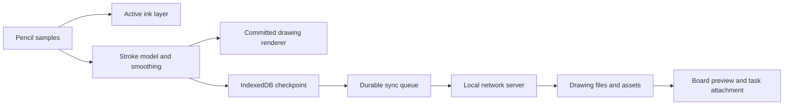

# Pencils iPad drawing view proposal

Research date: 16 October 2026. Baseline: Pencils 0.14.45. This is a product and engineering proposal. No physical iPad, Apple Pencil or Concepts performance comparison was available during this audit.

# Recommendation

Add a dedicated **Drawing** view, connected to the existing project and accessible from an iPad over the local network. Use the board to organize and discuss drawings, and a focused drawing surface to create them. The drawing engine must render and save locally on the iPad before synchronizing with the server; network latency must never determine when ink appears.

Start with a short browser prototype on the actual iPad and Pencil. If it meets the feel and durability targets below, build a browser/PWA first release. If excellent handwriting and full Pencil hardware behavior remain out of reach, use a native iPad drawing client connected to the same Pencils API. A web wrapper alone would not solve an unsuitable ink engine.

# What to learn from Concepts

Concepts combines an infinite canvas with editable strokes and configurable drawing tools. Its workspace supports movable tool controls; its layers can be arranged manually or automatically by tool; precision tools provide guides and grids. These are useful interaction references, not a reason to reproduce its entire feature set. [Concepts manual](https://concepts.app/en/manual), [Workspace](https://concepts.app/en/manual/workspace), [Layers](https://concepts.app/en/manual/layers), [Precision tools](https://concepts.app/en/manual/precision-tools).

Its brush controls include pressure, tilt, velocity and smoothing behavior, alongside different pen and pencil tools. The important lesson is that drawing feel depends on how samples become strokes, not simply on adding more brush icons. [Brushes and tools](https://concepts.app/en/manual/brushes-and-tools).

## Ten capabilities to build

| # | Capability | Proposed behavior | Stage |
| --- | --- | --- | --- |
| 1 | Infinite canvas | Smooth pan, zoom and rotation; reset rotation; fit drawing without disturbing saved position. | MVP |
| 2 | Pencil and finger separation | Pencil draws; two fingers navigate. Optional finger drawing for people without a Pencil. | Prototype and MVP |
| 3 | Five dependable tools | Fixed-width pen, pressure pen, pencil, highlighter and eraser. Start with excellent basics. | MVP; textured pencil can follow |
| 4 | Tool presets | A compact movable strip with favorite size, color and opacity combinations; support left-handed placement. | MVP |
| 5 | Adjustable feel | Pressure curve and stabilization settings with a live test area; quick raw versus smooth comparison. | Prototype and MVP |
| 6 | Layers | Create, rename, hide, lock, reorder and change opacity. Optional automatic layers later. | MVP then refinement |
| 7 | Editable strokes | Lasso, move, scale, duplicate, recolor and change width without flattening the drawing. | MVP then refinement |
| 8 | References and annotation | Import images, preserve originals, lock a reference layer and draw over it. Add PDF pages later. | Images in MVP; PDF later |
| 9 | Precision assistance | Dots, graph and isometric grids; straightedge and angle snapping; guides are optional and easy to disable. | Refinement |
| 10 | Project integration | Link drawings to tasks and boards, export PNG/SVG, create a draft task from a selection, and share a read-only preview. | MVP then refinement |

These are proposed Pencils behaviors. OCR, handwriting search, shape recognition improvements, presentation recording and simultaneous multi-person ink are later options, not prerequisites for a satisfying first release.

# Interface

A project gets a Drawings gallery with thumbnails, title, last edit, linked task and sync state. Opening a drawing presents a nearly full-screen canvas. A small header retains the project breadcrumb, drawing title, comments, export and close controls. Reuse existing icons, color picker, themes, menus and keyboard conventions; make touch targets comfortable without making the whole interface oversized.

The tool strip can dock to either side. Put Undo and Redo within thumb reach, alongside the selected tool, size and color. A deliberate action opens layers or settings; tool popovers should not cover the point where the Pencil is drawing. Offer a focus mode that hides secondary UI and a clear way to exit it.

Two-finger pan, pinch and rotate should be one continuous gesture around a stable anchor. Ignore incidental palm touches while a pen stroke is active, and resolve gesture changes explicitly instead of interpreting every pointer independently. Test edge-of-screen writing, Pencil lift, application switching and interrupted pointer capture.

A drawing on a board should appear as a linked preview with an Open drawing action. Board resizing changes the preview, not the underlying stroke coordinates. Comments can attach to the drawing or a selected region. Turning handwriting into a draft task should initially ask for a title; OCR can be added later with a clear choice of local processing or cloud processing.

# Current code and the required change

Pencils already has pressure-aware pen and highlighter tools, coalesced pointer-event sampling, partial erasure, lasso selection and two-finger navigation. This is a useful starting point. It is not yet evidence of Concepts-like latency.

| Observation from the current code | Implication | Proposed change |
| --- | --- | --- |
| `public/pen-model.js` builds a separate SVG path for many pressure segments | Long strokes can create many DOM elements | Render committed ink to canvas or GPU-backed tiles; retain editable stroke data separately |
| `public/canvas.js` rebuilds the active SVG preview from all samples on animation frames | Work increases as a stroke grows | Append samples and redraw only a small active region |
| Pressure is captured, but the stored samples do not provide a full timestamp/tilt input model | Limited expressive tools and velocity-dependent smoothing | Introduce a versioned stroke format with time, pressure and optional tilt/twist |
| There is a 10,000-point per-stroke bound | Very long strokes need a defined continuation policy | Split storage into continuous chunks without breaking the visible stroke |
| No service worker or IndexedDB implementation was found | Existing offline queues do not provide a fully offline-startable drawing app | Add an offline shell, local drawing store and durable outbox |
| Board saves use bounded whole-document JSON | Dense drawing data should not grow indefinitely inside a board node | Store drawing documents and assets separately; boards reference IDs and previews |

Keep ordinary board shapes and task cards on their existing implementation initially. Build an isolated ink engine with a shared document adapter; avoid a full board rewrite merely to improve drawing.

# Ink engine design

Use a fast active-ink overlay and a separate committed renderer. Capture real samples with timestamps; use coalesced samples when available. Keep raw data or enough source information to reprocess smoothing later. Interpolate width smoothly, preserve corners, and make stabilization adjustable: aggressive smoothing can make a stroke feel delayed even if it looks attractive.

Predicted pointer samples can provide a temporary leading segment, but predictions must be replaced by real input and never persisted as authoritative stroke data. Feature-detect this API and degrade gracefully. WebKit has shipped fixes around coalesced and predicted pointer events, so testing the actual Safari version matters. [Predicted events](https://developer.mozilla.org/en-US/docs/Web/API/PointerEvent/getPredictedEvents), [WebKit Safari 18.3 changes](https://webkit.org/blog/16439/webkit-features-in-safari-18-3/).

Store strokes as centerlines with pressure, tool parameters, transform, color and stable IDs. Maintain a spatial index so selection, erasing and redraw do not scan the entire drawing. Use tile caches, viewport culling and bounded device-pixel-ratio rendering to control memory. Keep an export renderer separate so screen optimizations do not reduce export quality.

Benchmark Canvas 2D first with the target brush set. Move committed rendering or brush texture work to WebGL only when measured workloads justify the complexity. Worker or OffscreenCanvas support is an optimization to detect, not a mandatory browser assumption.

Undo should operate on meaningful actions: one stroke, one erased section, one transform, one image import. It must survive ordinary navigation within the session and never undo somebody else's work unexpectedly. First release should use one active drawing editor with read-only viewers or explicit ownership transfer; concurrent editable ink needs a separate operation-merging design.

# Connecting the iPad over the local network

The deployment can remain local. Run Pencils on the computer or server, keep that machine awake, put the iPad on the same reachable network and open its address in Safari. Guest Wi-Fi isolation or a firewall can prevent access even when the network names look similar. An installation page should show the correct address and a QR code, without exposing a permanent authentication token in it.

For the polished drawing view, configure a **stable HTTPS address trusted by the iPad**. A private LAN HTTP address is not the localhost secure-context exception. Service workers require a secure context, and advanced pointer APIs can also have secure-context requirements. Merely clicking through a certificate warning is not a reliable installation strategy. The repository already has an HTTPS deployment route, so build a guided setup around that rather than inventing a second server. [Service workers](https://developer.mozilla.org/en-US/docs/Web/API/Service_Worker_API), [PointerEvent](https://developer.mozilla.org/en-US/docs/Web/API/PointerEvent).

Use required authentication for a shared installation, secure cookies over HTTPS and explicit project access. No public port forwarding is needed for this LAN use case. OAuth integrations still need outbound internet and a correctly registered callback flow; the drawing canvas itself should continue working without it.

Installing the web app to the iPad home screen can provide a more focused experience after offline caching is implemented. It does not guarantee unlimited storage or continuous background sync. Show **Saved on this iPad** separately from **Synced to server**, and give the user an export/recovery action when uploads fail.

# Storage and recovery

Save completed strokes to IndexedDB before reporting them locally saved. Keep an append-style operation log, periodic document checkpoints and a durable upload queue. Checkpoint very long in-progress strokes in chunks so an interruption does not discard minutes of work. A failed storage write must be visible; continuing to draw while silently dropping persistence is unacceptable.

The server should store a versioned drawing document plus assets and generated previews, with atomic checkpoint replacement and recoverable history. Markdown tasks and Canvas boards can link those files. An SVG preview is useful in Obsidian, but it should not be the only editable representation. Document the format and provide a portable export package.

For reference images, preserve the original file while rendering a suitably sized preview. Correct orientation, cap decode dimensions and avoid keeping several full-resolution image copies in memory. Deleted layers and strokes should be recoverable through undo/history until the retention policy expires.

# Browser versus native iPad client

| Concern | Browser/PWA | Native client with PencilKit or a custom renderer |
| --- | --- | --- |
| Deployment | Existing server and URL; easiest to update | App installation and signing/distribution |
| Pressure and tilt | Available through browser input where supported; test devices | Strong platform integration |
| Palm behavior | Browser events and gesture heuristics; actual quality must be tested | Better access to platform drawing behavior |
| Pencil Pro features | Do not promise complete squeeze, hover, roll or haptics parity | Hardware-dependent native APIs are available |
| Offline documents | IndexedDB and service worker; storage lifecycle constraints | Native local files/database and background facilities |
| Custom tools | Flexible, but engine work is substantial | PencilKit supplies native ink; unusual brushes or infinite-canvas behavior can still need custom work |
| Portability | Easy access on other tablets and desktop | Requires a portable interchange format alongside native storage |
| Recommendation | Prove feel first, then use for MVP if it passes | Choose if the browser prototype misses the required experience |

Apple describes PencilKit as a native low-latency drawing framework with editable drawing data. UIKit separately exposes Pencil interactions such as double tap and squeeze on supported hardware. Those APIs are not automatically available to a website. An open WebKit request concerning Pencil Pro features reinforces the need to avoid promising complete browser parity. [PencilKit](https://developer.apple.com/documentation/pencilkit), [Pencil interactions](https://developer.apple.com/documentation/uikit/uipencilinteraction), [WebKit Pencil Pro request](https://bugs.webkit.org/show_bug.cgi?id=296943).

If native is chosen, share project authentication, drawing IDs, previews and sync endpoints with the web app. Decide whether the canonical editable format is a portable stroke model, native `PKDrawing` plus a fallback, or both. Conversion between different brush models will not necessarily be lossless.

# What satisfying means in measurable terms

These are proposed acceptance targets, not current measured results or guarantees.

| Test | Target or decision rule |
| --- | --- |
| Frame stability | Sustain the device's practical refresh rate while drawing; 60 Hz fallback has a 16.7 ms budget and 120 Hz has 8.3 ms |
| Input processing | Aim for under 4 ms p95 app-side active-ink work on the target iPad; measure rather than infer from FPS |
| Visible latency | Compare tip-to-ink delay with Concepts on the same hardware using high-speed video; initially target roughly 30–40 ms or better, then tune to user preference |
| Long strokes | No increasing lag or visible breaks during a continuous two-minute stroke |
| Handwriting | Small letters, fast diagonals, dots and deliberate corners remain recognizable without unwanted tails |
| Palm and gestures | Twenty minutes of natural left- and right-handed writing without accidental marks, zoom jumps or stuck tools |
| Large drawings | Benchmark 10,000 and 50,000 strokes with images; establish a documented supported envelope |
| Interruption | Switch apps, lock the iPad and cancel pointers without corrupting a stroke or leaving capture stuck |
| Offline durability | Disconnect Wi-Fi for 30 minutes; completed strokes survive reload after local save, then synchronize once without duplicates |
| Thermal and battery behavior | Run a sustained session and measure memory, heat and battery impact rather than relying on a short demo |

Do not treat a desktop Playwright test or a simulated mobile viewport as proof of Apple Pencil quality. Test at least the user's own iPad/Pencil and an older supported iPad, with current Safari and the home-screen installation. Record exact hardware and OS versions.

# Delivery and effort

Estimates are person-days for one experienced developer, including targeted testing, excluding hardware procurement and distribution approval. Stages are incremental.

| Stage | Deliverable | Estimate |
| --- | --- | --- |
| 1 | Physical-device prototype: input, pressure curve, local renderer, gestures and Concepts comparison | 3–5 days |
| 2 | Usable web Drawing view: basic tools, layers, lasso, images, local persistence, LAN sync and board preview | Additional 15–25 days |
| 3 | Polish: pressure calibration, texture quality, guides, export fidelity, large documents and recovery testing | Additional 20–35 days |
| 4 | Optional PDF annotation, OCR, advanced brush editor or concurrent ink | Estimate after choosing scope |

A polished browser release is approximately **38–65 person-days** across the first three stages. A native alternative might require roughly **6–12 weeks** for a focused client, with the estimate revised after deciding the drawing format and tool set; it is an alternative implementation path, not a free add-on.

The first decision should be the feel of the prototype. Keep the shared project model and drawing format independent of the rendering choice so that a native client remains possible without replacing the rest of Pencils.
